# BuildCost AI — Feature-Based (Vertical Slice) Architecture Specification

This document outlines the **Feature-Based (Domain-Driven / Vertical Slice) Architecture** for **BuildCost AI**. 

Unlike traditional horizontal layering (which separates all frontend code into `frontend/` and all backend code into `backend/`), this architecture organizes the system around **User-Facing Features and Business Capabilities**. Each feature module is self-contained, enclosing its user interactions, UI views, state management, API routes, domain logic, and data persistence models.

---

## 1. Architectural Philosophy & Core Principles

### 1.1 Horizontal Layering vs. Feature-Based Architecture

| Dimension | Traditional Horizontal Layering | Feature-Based Architecture (BuildCost AI) |
|---|---|---|
| **Organization** | By technical stack (`frontend/`, `backend/`, `db/`) | By user capability & business domain (`features/auth`, `features/optimizer`) |
| **Code Cohesion** | Low (changing 1 feature requires touching 4+ folders) | High (all code for 1 feature lives in 1 module) |
| **Developer Autonomy** | High coupling, high risk of side effects | Independent feature development & isolated testing |
| **User Access Model** | Generic API endpoints & monolithic UI routing | Feature-oriented user journeys & modular feature permissions |
| **Scalability** | Harder to split or refactor | Easily converted to microservices/micro-frontends if needed |

### 1.2 Core Architectural Rules
1. **Vertical Cohesion**: A feature module contains everything required to deliver a specific capability to the user — from the UI component to the database entity.
2. **Explicit Module Boundaries**: Feature modules communicate with each other only through public feature interfaces (`index.js` / `public_api.py`) or via domain events.
3. **Shared Core Isolation**: Cross-cutting concerns (DB connection, JWT secret verification, UI design system tokens, base HTTP client) reside in a slim `core/` package and are imported by features as needed.
4. **Feature-Based User Access Control**: User access, navigation tabs, and permissions are mapped directly to Feature Modules (e.g., `procurement_optimizer:read`, `projects:write`).

---

## 2. System Architecture Overview

```mermaid
graph TD
    User([User / Construction Manager])

    subgraph FeatureModules ["Feature Modules (Vertical Slices)"]
        subgraph AuthMod ["Feature Module 1: Auth & Access (`feature_auth`)"]
            AuthUI[Login / Register UI] <--> AuthAPI[Auth Endpoints & JWT Logic]
        end

        subgraph OptMod ["Feature Module 2: Procurement Optimizer (`feature_procurement_optimizer`)"]
            OptUI[Input Form & Forecast Charts] <--> OptAPI[BOM Trajectory & Optimal Window Engine]
        end

        subgraph FairMod ["Feature Module 3: Fair Price Auditor (`feature_fair_price`)"]
            FairUI[Vendor Quote Audit Card] <--> FairAPI[Fair Price Engine & Quote Logger]
        end

        subgraph ProjMod ["Feature Module 4: Project Lifecycle Manager (`feature_projects`)"]
            ProjUI[Project List & Phase Timeline] <--> ProjAPI[Project & Phase CRUD Service]
        end

        subgraph RepMod ["Feature Module 5: Report Generator (`feature_report_generator`)"]
            RepUI[Report Export Controls] <--> RepAPI[WeasyPrint / ReportLab PDF Streamer]
        end

        subgraph MktMod ["Feature Module 6: Market Intelligence (`feature_market_intelligence`)"]
            MktUI[Health & PWD Anchor Cards] <--> MktAPI[SQLite PWD/WPI Baseline Lookup]
        end
    end

    subgraph SharedCore ["Shared Core Platform (`core/`)"]
        CoreDB[(SQLite buildcost.db)]
        CoreHTTP[Axios / Base API Client]
        CoreDesign[CSS Tokens & Layout Shell]
        CoreSecurity[Password Hashing & JWT Core]
    end

    User -->|Access Feature 1| AuthMod
    User -->|Access Feature 2| OptMod
    User -->|Access Feature 3| FairMod
    User -->|Access Feature 4| ProjMod
    User -->|Access Feature 5| RepMod
    User -->|Access Feature 6| MktMod

    AuthMod --> CoreSecurity
    AuthMod --> CoreDB
    OptMod --> CoreDB
    OptMod --> CoreHTTP
    FairMod --> CoreDB
    ProjMod --> CoreDB
    RepMod --> CoreDB
    MktMod --> CoreDB
```



---

## 3. Directory & File Structure Blueprint

Under this architecture, the repository is structured into modular feature packages:

```
COSTBUILD AI/
├── FEATURE_BASED_ARCHITECTURE.md   # [This Document] Architecture Specification
├── README.md                        # Quickstart & setup guide
├── buildcost.db                     # SQLite Database (Core Storage)
├── config.py                        # Environment & System Config
│
├── core/                            # Shared Platform Core (Cross-Cutting Concerns)
│   ├── database/                    # DB connection pool, base ORM/SQLite handlers
│   │   ├── connection.py
│   │   └── migrations/
│   ├── security/                    # Hashing, token encoding/decoding utilities
│   │   ├── jwt.py
│   │   └── hashing.py
│   ├── http/                        # Shared API client & Axios interceptors
│   │   └── client.js
│   └── ui_system/                   # Common styles, tokens, base components
│       ├── tokens.css
│       ├── LayoutShell.jsx
│       └── HeaderNav.jsx
│
├── features/                        # FEATURE MODULES (Vertical Slices)
│   │
│   ├── auth/                        # Feature 1: Identity & Access Management
│   │   ├── ui/                      # Login.jsx, Register.jsx
│   │   ├── api/                     # router.py (/auth/register, /auth/login)
│   │   ├── service/                 # user_service.py
│   │   └── state/                   # AuthContext.jsx
│   │
│   ├── procurement_optimizer/       # Feature 2: BOM Cost & Procurement Optimizer
│   │   ├── ui/                      # InputForm.jsx, ForecastChart.jsx, RecommendationCard.jsx
│   │   ├── api/                     # router.py (/predict-optimal-build-window)
│   │   ├── service/                 # bom_optimizer.py, drift_forecast.py
│   │   └── schemas/                 # optimization_dto.py
│   │
│   ├── fair_price_check/            # Feature 3: Vendor Quote Fair Price Auditor
│   │   ├── ui/                      # VendorQuoteCard.jsx
│   │   ├── api/                     # router.py (/check-fair-price)
│   │   ├── service/                 # fair_price_engine.py
│   │   └── repository/              # vendor_quotes_repo.py
│   │
│   ├── projects_manager/            # Feature 4: Multi-Phase Project Timeline
│   │   ├── ui/                      # ProjectList.jsx, ProjectDetail.jsx, PhaseTimeline.jsx
│   │   ├── api/                     # router.py (/projects, /projects/{id}/phases)
│   │   └── service/                 # project_service.py
│   │
│   ├── report_generator/            # Feature 5: PDF Executive Report Generator
│   │   ├── ui/                      # ReportExportButton.jsx
│   │   ├── api/                     # router.py (/generate-report)
│   │   └── service/                 # pdf_generator.py, templates/
│   │
│   └── market_intelligence/         # Feature 6: PWD Rate Anchors & WPI Drift
│       ├── ui/                      # AnchorConversionCard.jsx, HealthBadge.jsx
│       ├── api/                     # router.py (/health, /rates)
│       └── service/                 # pwd_rate_service.py
│
└── main.py                          # Feature Registry & FastAPI Application Entry Point
```

---

## 4. Comprehensive Feature Module Specifications

### 4.1 Feature Module 1: Identity & Access Management (`features/auth`)

* **User Capabilities**:
  * Register new construction manager account (Email, Password, Name, Company).
  * Authenticate user & receive JWT access token.
  * Persist login session and automatically authorize feature requests.
* **Module Composition**:
  * **UI Components**: `Login.jsx`, `Register.jsx`, `AuthContext.jsx`
  * **API Routes**: `POST /auth/register`, `POST /auth/login`, `GET /auth/me`
  * **Domain Logic**: Password hashing (`passlib`/`bcrypt`), JWT encoding & validation (`PyJWT`).
  * **Database Table**: `users` (id, email, hashed_password, full_name, company, created_at).

---

### 4.2 Feature Module 2: BOM Procurement Window Optimizer (`features/procurement_optimizer`)

* **User Capabilities**:
  * Input project size (square feet) and select target construction materials (steel, cement, sand, brick, gravel, wiring).
  * Calculate initial Bill of Materials (BOM) quantities and costs using PWD Schedule of Rates.
  * Project 12-month forward price trajectories using dynamic WPI drift extrapolation.
  * View optimal procurement month recommendation and potential cost savings (₹ and %).
* **Module Composition**:
  * **UI Components**: `InputForm.jsx`, `ForecastChart.jsx`, `BomTable.jsx`, `RecommendationCard.jsx`, `LimitationNotice.jsx`
  * **API Routes**: `POST /predict-optimal-build-window`
  * **Domain Logic**: `bom_optimizer.py` (naive + drift extrapolation algorithm, material weightings, monthly cost aggregation).
  * **Data Schemas**: `OptimizationRequest`, `OptimizationResponse`.

---

### 4.3 Feature Module 3: Vendor Quote Fair Price Auditor (`features/fair_price_check`)

* **User Capabilities**:
  * Submit vendor quote details (material, quoted unit price, unit type, quote date, vendor notes, region).
  * Instantly audit quote against PWD rates + WPI index drift trajectory for that exact calendar month.
  * Receive visual market verdict (`above market`, `at market`, `below market`, `unit mismatch`).
  * Log quote entries to the project audit ledger for historical vendor evaluation.
* **Module Composition**:
  * **UI Components**: `VendorQuoteCard.jsx`
  * **API Routes**: `POST /check-fair-price`
  * **Domain Logic**: Unit normalization engine, ±5% fair price band logic, baseline comparison calculator.
  * **Database Table**: `vendor_quotes` (id, project_id, phase_id, material, quoted_rate, quoted_unit, baseline_rate, deviation_pct, verdict).

---

### 4.4 Feature Module 4: Multi-Phase Project Manager (`features/projects_manager`)

* **User Capabilities**:
  * Create, view, and manage construction projects (Project Name, Sqft, Location Region, Target Materials).
  * Create construction phases (Foundation, Superstructure, Roofing, Finishing) with start dates, durations, and allocated budget.
  * View real-time phase timelines and material cost distribution per construction milestone.
* **Module Composition**:
  * **UI Components**: `ProjectList.jsx`, `ProjectDetail.jsx`, `PhaseTimeline.jsx`, `PhaseForm.jsx`, `ProjectSelector.jsx`
  * **API Routes**: `GET /projects`, `POST /projects`, `GET /projects/{id}`, `POST /projects/{id}/phases`
  * **Domain Logic**: Phase timeline alignment, project-scoped BOM calculations.
  * **Database Tables**: `projects`, `project_phases`.

---

### 4.5 Feature Module 5: PDF Executive Report Generator (`features/report_generator`)

* **User Capabilities**:
  * Export comprehensive executive PDF reports for clients, banks, or procurement managers.
  * Includes forecast trajectory graphs, BOM breakdown tables, reference anchors, vendor quote audit history, and model disclosures.
* **Module Composition**:
  * **UI Components**: Integrated report download actions across header & project details.
  * **API Routes**: `POST /generate-report`
  * **Domain Logic**: WeasyPrint HTML-to-PDF engine with automatic ReportLab fallback renderer.
  * **Templates**: Embedded HTML/CSS executive report layout templates.

---

### 4.6 Feature Module 6: Market Rates & WPI Intelligence (`features/market_intelligence`)

* **User Capabilities**:
  * View active PWD reference rates and WPI baseline index conversion rates.
  * Monitor real-time system health and SQLite database connectivity status.
* **Module Composition**:
  * **UI Components**: `AnchorConversionCard.jsx`, `HealthBadge.jsx`, `ProcurementEngineGuide.jsx`
  * **API Routes**: `GET /health`
  * **Domain Logic**: PWD Schedule of Rates lookup table, WPI historical index query engine.
  * **Database Tables**: SQLite index tables (`wpi_indices`, `pwd_anchor_rates`).

---

## 5. User-Centric Access Flow & Navigation Mapping

In this feature-based architecture, user access is routed directly by feature domain:

```
User Route / Feature Access Point           ---> Accesses Feature Module
---------------------------------------------------------------------------------------
1. /app/auth                                 ---> features/auth
2. /app/optimizer (Procurement Window)       ---> features/procurement_optimizer
3. /app/fair-price (Vendor Quote Audit)      ---> features/fair_price_check
4. /app/projects (Timeline & Phase Manager)  ---> features/projects_manager
5. /app/reports (Executive Export)           ---> features/report_generator
6. /app/intelligence (PWD Rates & Health)    ---> features/market_intelligence
```

### Request Execution Flow Within a Feature Slice:
1. User interacts with UI component in `features/<feature_name>/ui/`.
2. UI component invokes local feature API client or state action in `features/<feature_name>/api/` / `state/`.
3. Backend router in `features/<feature_name>/api/` receives the request.
4. Backend router delegates work to `features/<feature_name>/service/`.
5. Domain service accesses `core/database/` to execute SQLite operations or query PWD/WPI data.
6. Structured response is returned up the slice to update the feature UI state.

---

## 6. Current Mapping vs. Target Feature Layout

To transition seamlessly from the current codebase to the Feature-Based Architecture:

| Current File Location | Target Feature-Based Location |
|---|---|
| `frontend/src/components/Login.jsx` & `Register.jsx` | `features/auth/ui/` |
| `src/api/auth.py` | `features/auth/api/router.py` |
| `frontend/src/components/InputForm.jsx` & `ForecastChart.jsx` | `features/procurement_optimizer/ui/` |
| `src/optimization/bom_optimizer.py` | `features/procurement_optimizer/service/` |
| `frontend/src/components/VendorQuoteCard.jsx` | `features/fair_price_check/ui/` |
| `src/api/main.py` (`/check-fair-price`) | `features/fair_price_check/api/router.py` |
| `frontend/src/components/ProjectList.jsx` & `PhaseTimeline.jsx` | `features/projects_manager/ui/` |
| `src/api/projects.py` | `features/projects_manager/api/router.py` |
| `src/reports/generator.py` | `features/report_generator/service/` |
| `frontend/src/components/HealthBadge.jsx` & `AnchorConversionCard.jsx` | `features/market_intelligence/ui/` |
| `buildcost.db` & database scripts | `core/database/` |

---

## 7. Benefits of this Feature-Based Architecture

1. **User Access Feature Alignment**: Features map 1:1 with user capabilities. When adding or modifying a feature (e.g., adding "Vendor Quote Comparison"), all related files live inside `features/fair_price_check/`.
2. **Simplified Onboarding & Maintainability**: Developers working on procurement optimization do not need to wade through project management or PDF reporting files.
3. **High Modularity**: Each feature can be tested in isolation or independently upgraded without breaking other modules.
4. **Clean Dependency Graph**: `core` contains no feature business logic; features depend on `core`, but features never cross-depend directly without explicit interfaces.
